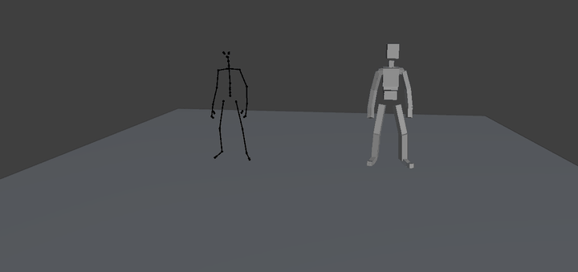
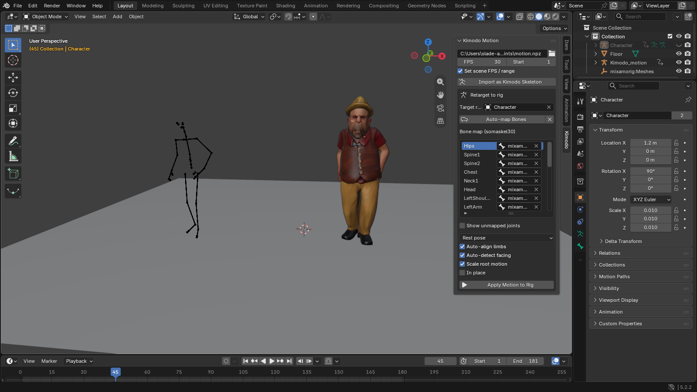

# Kimodo Motion Importer for Blender

Import motions generated with [Kimodo](https://github.com/nv-tlabs/kimodo) (`.npz`) into Blender and
apply them to **your own rigged character**: Mixamo, Rigify, Unreal, VRM, Character Creator, and more.

## Features

- Import Kimodo NPZ motions (SOMA, SMPL-X and G1 skeletons are detected automatically)
- Retarget onto any humanoid rig with **automatic bone mapping**
- Works with T-pose and A-pose rigs, any facing direction, and FBX imports
- Root motion is scaled to your character's size; optional **In place** mode
- Bakes a normal Blender action, ready to edit or export to FBX/glTF

## Install

1. Download **[kimodo_npz_importer.zip](../../releases/latest/download/kimodo_npz_importer.zip)**
   (don't unzip it).
2. In Blender go to **Edit → Preferences → Get Extensions → ⌄ → Install from Disk...** and select
   the zip.
   On Blender 3.6 – 4.1, use **Preferences → Add-ons → Install...** instead, then enable the add-on.

## Usage

1. In the Kimodo demo, export your motion as **Exports → Motion → NPZ**.
2. In Blender, press **N** in the 3D Viewport and open the **Kimodo** tab.
3. Pick the `.npz` file and set **FPS** (usually 30).
4. Set **Target rig** to your character's **armature**, then click **Auto-map Bones**.
5. Click **Apply Motion to Rig** and press **Space** to play.

To preview the raw motion as a stick skeleton, use **Import as Kimodo Skeleton** (or
**File → Import → Kimodo Motion (.npz)**).

## Options

| Option | Description |
| --- | --- |
| Rest / Current pose | Which pose of your rig matches Kimodo's T-pose. Use *Current pose* if your rest pose is unusual. |
| Auto-align limbs | Fixes the arm and leg differences between A-pose and T-pose. |
| Auto-detect facing | Detects which way your character faces. |
| Scale root motion | Scales the hip movement to your character's height. |
| In place | Removes the forward travel. |

## Tips

- If a bone is wrong or missing, click its row in the bone map and pick the correct bone.
- For **Rigify**, target the metarig or the `DEF-` bones, not the control rig.
- For SMPL-X models, export as **NPZ**, not *AMASS NPZ*.

## License

Made by **AminHP**. Apache-2.0. Skeleton data comes from [Kimodo](https://github.com/nv-tlabs/kimodo)
by NVIDIA.
